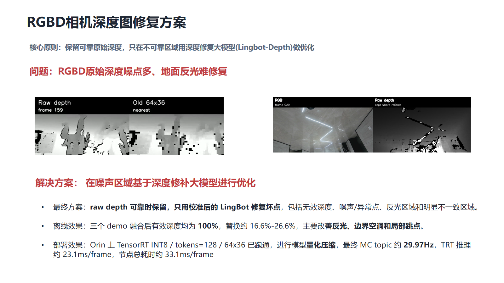
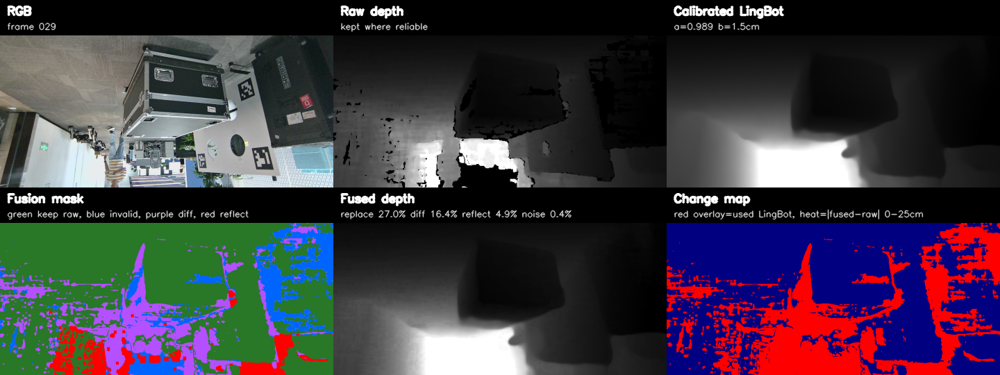
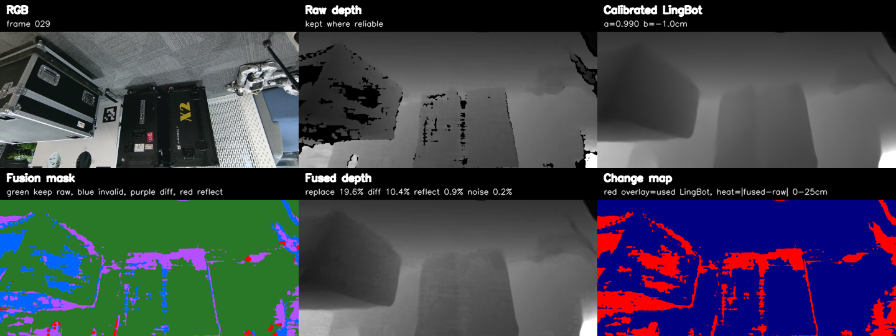
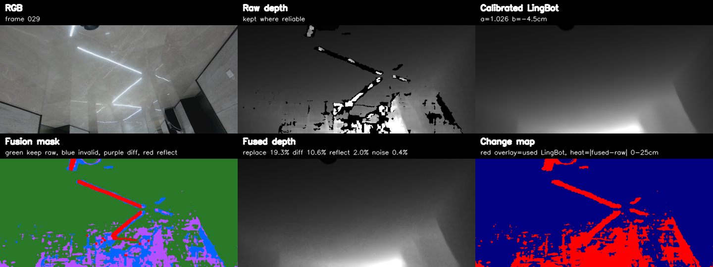
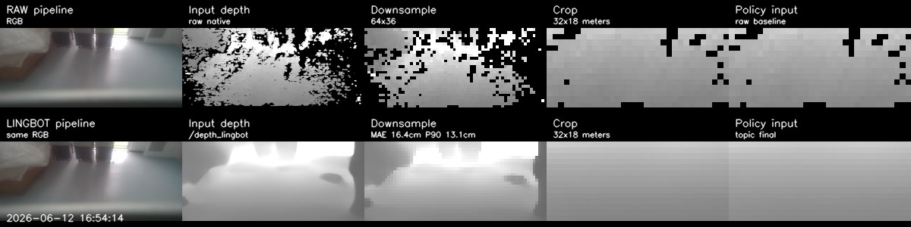

# RGBD-repair

[中文](README.md) | [English](README_EN.md)

An experiment and engineering record for RGB-D depth repair with LingBot-Depth. The repository contains the final calibrated local fusion strategy, three offline demos, and the historical TensorRT INT8 deployment on an Orin robot.

> Core principle: preserve reliable metric raw depth and use calibrated LingBot depth only in unreliable regions.



## Final Depth Repair Strategy

1. Run `robbyant/lingbot-depth-postrain-dc-vitl14` to predict LingBot depth.
2. Fit `raw_depth ≈ scale × lingbot_depth + bias` on reliable pixels for every frame.
3. Preserve raw depth by default and replace only:
   - invalid raw depth and its `3×3` neighborhood;
   - noise or anomaly pixels whose local median residual exceeds `max(6cm, 3.5% × raw)`;
   - RGB specular regions expanded with an `11×11` neighborhood;
   - pixels where raw depth and calibrated LingBot differ by more than `max(8cm, 4% × raw)`.
4. Do not use temporal filtering or block-wise robust downsampling.

Final quality configuration: `max_side=320`, `tokens=300`, `max_depth=50m`, FP16.

See [Final Fusion Strategy](docs/final_strategy.md) for implementation details.

## Offline Demos

All three demos reach `100%` valid fused depth. The replacement ratio is approximately `16.6%–26.6%`.

| Demo | Raw valid | Fused valid | Replaced | Scale / bias |
|---|---:|---:|---:|---:|
| 115349 | 89.82% | 100% | 26.56% | 0.981 / +2.6cm |
| 183936 | 92.89% | 100% | 16.64% | 1.009 / -2.5cm |
| 194206 | 91.76% | 100% | 20.00% | 1.013 / -2.7cm |

### 115349



### 183936



### 194206



Comparison videos: [GitHub Release: demo-v1](https://github.com/jingyu198/RGBD-repair/releases/tag/demo-v1)

## Historical Orin Deployment

The robot deployment was a lightweight real-time version, not the final local-fusion quality configuration described above:

- TensorRT INT8 with static input `1×3×36×64` and `tokens=128`;
- PTQ entropy calibration using 90 frames from the three demos;
- full LingBot depth output without per-frame scale/bias calibration;
- the existing downstream pipeline converts LingBot depth into the `32×18` MC depth input.

Measured performance: final MC topic `29.967Hz`, TRT inference `23.134ms/frame`, total node time `33.137ms/frame`, and relay `dropped=0`.



See [Orin Deployment Record](docs/orin_deployment.md) for details.

## Run the Final Fusion Demo

```bash
python src/lingbot_confidence_fusion_video.py \
  --repo /path/to/lingbot-depth \
  --input /path/to/synced.npz \
  --output-dir output/final_fusion \
  --stem 115349 \
  --max-side 320 --num-tokens 300 --max-depth 50 \
  --calibrate-lingbot --aggressive \
  --diff-abs 0.08 --diff-rel 0.04 \
  --noise-abs 0.06 --noise-rel 0.035 \
  --small-area 2000 --invalid-dilate 3 --specular-dilate 11 \
  --max-samples 6000 --calib-downscale 4
```

## Repository Layout

```text
assets/       Images used by the READMEs
benchmarks/   Offline and Orin measurement JSON files
configs/      Final fusion and Orin configurations
deployment/   TensorRT quantization and ROS2 deployment code
docs/         Strategy notes and the 20260630 presentation
src/          Calibration and fusion implementation
tools/        Raw pipeline and policy-input visualization tools
```

Model weights, ONNX files, TensorRT engines, raw RGB-D data, and full videos are excluded from Git history. Videos are published as GitHub Release assets.

## Upstream Projects

- [robbyant/lingbot-depth](https://github.com/robbyant/lingbot-depth)
- [LingBot-Depth DC ViT-L/14 model](https://huggingface.co/robbyant/lingbot-depth-postrain-dc-vitl14)
